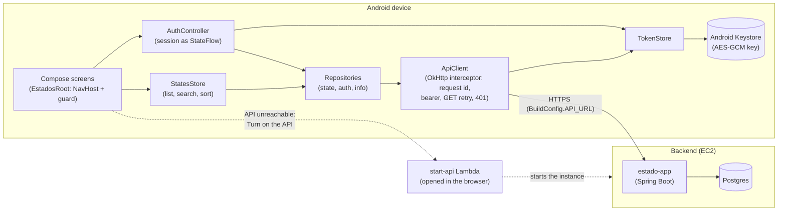

# android_state

[](https://github.com/ronybrand/android_state/actions/workflows/ci.yml)

CRUD for Brazilian federative units (states): abbreviation, name and created/updated timestamps.
It consumes the [Estado project](https://github.com/ronybrand/estado)'s REST API. This is the
**native Android** client for that backend, a sibling of
[react_state](https://github.com/ronybrand/react_state) (Next.js),
[vue_state](https://github.com/ronybrand/vue_state) (Vue 3),
[react_native_state](https://github.com/ronybrand/react_native_state) (Expo) and
[flutter_state](https://github.com/ronybrand/flutter_state) (Flutter). The domain, the validation
rules, the messages and the API contract are the same; the app follows Kotlin and Jetpack Compose
conventions instead of the web, React Native or Flutter ones.

## Stack

- Kotlin 2.4 (JDK 17 target), Android Gradle Plugin 9, `minSdk` 26, `targetSdk` 37
- [Jetpack Compose](https://developer.android.com/compose) with Material 3, Navigation Compose
- [OkHttp](https://square.github.io/okhttp/) for HTTP and `kotlinx.serialization.json` for the JSON
  tree, `kotlinx.coroutines` and `StateFlow` for state
- The Android Keystore (AES-GCM) for the session token
- Tests: JUnit 4, [Robolectric](https://robolectric.org/) with Compose UI tests, MockWebServer,
  `kotlinx-coroutines-test`; [Maestro](https://maestro.mobile.dev/) on an emulator in CI
- ktlint, detekt, Android lint (warnings are errors), Kover, CycloneDX SBOM, Trivy, CodeQL

No dependency-injection framework: the graph has one `AppContainer` and a handful of constructors.
Hilt would add a code generator for something a constructor already does.

## What differs from the other clients, and why

| Web (react_state / vue_state)             | This app                                                                          |
| ----------------------------------------- | --------------------------------------------------------------------------------- |
| JWT in `localStorage`                     | AES-GCM with a Keystore key, ciphertext in `SharedPreferences`, mirrored in memory |
| `/api` BFF proxy (CORS, CSP, IP forward)  | None: a native app has no origin and no CORS. `-PapiUrl=...` at build time         |
| Auth "loading" state, or a hydration gate | Token read in `Application.onCreate`, before the first frame                        |
| Router guard that waits for auth          | A `LaunchedEffect` on (session, route) sends a protected screen to the login        |
| `State` type                              | `FederativeUnit`: `State` already means too many things in Compose                  |
| Table, `<dialog>` confirmation            | `LazyColumn` + pull to refresh, `AlertDialog`                                       |
| axe-core accessibility run                | `assertAccessible` on every screen (48 dp targets, a label on every control), palette contrast, live-region errors, a sort direction read aloud |
| Footer: frontend commit from version.json | App version from the binary (`BuildConfig.VERSION_NAME`)                            |
| Page not found                            | None: only the app's own routes and deep links exist                                |

## Architecture



The app talks straight to the API: a native app has no origin, so there is no BFF proxy. The dashed
path is the [Turn on the API](#when-the-api-is-turned-off) link, shown only when the API does not
answer.

```
com.ronybrand.estados
├── EstadosApp, MainActivity, AppContainer   # process wiring; AppContainer builds the real graph
├── AppDependencies                          # what the screens need: the app wires real ones, tests wire fakes
├── core/      ApiClient (OkHttp interceptor: request id, bearer, GET retry, 401), TokenStore,
│              KeystoreKeyValueStore, Jwt, Config, SessionEvents, FormatDate, Uuid, Attempt
├── data/      FederativeUnit + the anti-corruption mapping, validation, the three repositories
├── auth/      AuthController (StateFlow of the session) and ExpiryTimer
├── state/     StatesStore: the list, its search and sort, reloaded after every write
└── ui/        Theme, EstadosRoot (NavHost + guard), screens/, components/

app/src/test/  mirrors main; support/ holds the fakes and the app harness
app/src/e2e/   manifest and network config for the build type the Maestro flows install
e2e/           mock API (Node, zero dependencies), Maestro flows, the runner script
```

### Android and Kotlin conventions

- **A store owns state; composables stay thin.** `StatesStore` and `AuthController` are plain classes
  with `StateFlow`s and a `CoroutineScope`, so they are tested with `runTest` and no Android at all.
  Screens keep only local concerns (a text field, the search debounce, an in-flight flag).
- **The list keeps its rows while a search or sort reloads.** `StatesUiState` carries `units` and
  `loading` together, so there is no spinner flash per keystroke, and a reload that starts cancels
  the one in flight: an older, slower answer can never overwrite a newer one.
- **A failed first load shows the error and a "Try again" button**, never an empty-state message
  (it is not empty) and never a spinner that does not stop.
- **Network I/O stays off the main thread.** The call is enqueued on OkHttp's dispatcher and the body
  is read on `Dispatchers.IO`; Android would throw `NetworkOnMainThreadException` otherwise.
- **`attempt { }` instead of `runCatching`**: a cancelled coroutine stays cancelled. It is the one
  place the app catches every exception, because any failed call is shown to the user the same way.
- **A form screen closes by popping the back stack**, or lands on the list when opened cold (a deep
  link) and there is nothing to pop.
- **Compose test tags are also resource ids** (`testTagsAsResourceId`), so the Compose tests and the
  Maestro flows find the same elements.
- The backend's JSON contract (`sigla`, `nome`, ...) and the `/estado` path are the real wire
  contract and are **not** translated; `FederativeUnit.fromJson` is the anti-corruption layer.
- User-facing text is English and lives in the composables, like in the other clients; move it to
  string resources the day a second language is needed.
- No async side effects (queues, notifications) exist in this client, so there is nothing to move off
  the request path.

### When the API is turned off

To save cost, the backend instance is stopped while the project isn't in use. When the API doesn't
answer (no response, timeout or 502/503/504), the error message says so and offers a **Turn on the
API** link. It opens a page served by the backend's `start-api` Lambda (anti-bot challenge, starts the
instance, waits for the API to come back; the instance stops by itself after 2 hours), see
[ADR 0026](https://github.com/ronybrand/estado/blob/master/docs/adr/0026-ligar-api-sob-demanda.md). Implemented in `core/ApiClient.kt`.

## Running

Open the project in Android Studio, or from a shell with an Android SDK (`ANDROID_HOME` or
`local.properties`):

```bash
./gradlew :app:installDebug                                   # a connected device or emulator
./gradlew :app:installDebug -PapiUrl=https://api.example.com  # another backend
```

`apiUrl` is compiled into the binary (`BuildConfig.API_URL`), so it is readable by anyone with the
app: never put a secret there. It must be absolute `http(s)`; trailing slashes are dropped. The
default is the public deployment of the same API reached through the web app's proxy
(`https://react-state-flax.vercel.app/api`), fine for trying the app and not for anything else. On an
emulator the host machine is `http://10.0.2.2:<port>`; Android blocks cleartext `http://` in release
builds, so a real deployment must be `https`.

Demo credentials (intentionally public): see the backend's README, also shown on the login screen.
Deep links: `estados://state/new` and `estados://state/{id}/edit` (the guard still applies).

## Scripts

```bash
./gradlew testDebugUnitTest      # 143 tests, JVM only (Robolectric draws the Compose screens)
./gradlew koverVerify            # line coverage floor of 90% (about 98% measured)
./gradlew ktlintCheck detekt lintDebug
./gradlew :app:assembleRelease   # minified; unsigned without key.properties
./gradlew :app:assembleE2e -PapiUrl=http://localhost:4010 && bash e2e/run-flows.sh   # needs an emulator and Maestro
```

CI runs ktlint, detekt, Android lint, the tests and the coverage floor; the release signing check; a
Trivy scan; CodeQL; the SBOM scan; the dependency review; and, on an emulator, the Maestro flows
against the mock API.

The coverage report leaves out the process wiring (`EstadosApp`, `MainActivity`, `AppContainer`) and
`KeystoreKeyValueStore`, which needs the `AndroidKeyStore` provider that only exists on a device. The
Maestro flow that signs in, restarts the app and finds the session still open is what exercises it.

## Release signing

A release build is signed with an **upload key** that only you hold. Google Play requires every
update to be signed with the same one, so **losing it means losing the ability to update the app**:
keep a backup somewhere safe, and never commit it (`key.properties`, `*.jks` and `*.keystore` are
git-ignored).

```bash
# 1. Create the key once (keep the file and both passwords safe)
keytool -genkey -v -keystore ~/upload-keystore.jks -keyalg RSA -keysize 2048 \
        -validity 10000 -alias upload

# 2. Point the build at it, in key.properties at the repository root. keytool makes a PKCS12 keystore,
#    where the key password is the keystore password: use the same value for both.
#      storeFile=/home/you/upload-keystore.jks
#      storePassword=...
#      keyAlias=upload
#      keyPassword=...

# 3. Build the bundle to upload to Google Play (the version code must grow every time)
./gradlew :app:bundleRelease -PversionCode=2
```

Without `key.properties`, `assembleRelease` produces an unsigned APK, but `bundleRelease` **refuses to
build** and says why: such a bundle would be unsigned, and Google Play rejects it. Enrolling in **Play
App Signing** is recommended: Google then holds the real signing key and yours is only an upload key,
which support can reset if it is ever lost.

**From CI**: the `Release (Android)` workflow (manual, `workflow_dispatch`) builds the signed bundle
from these repository secrets and attaches it as an artifact:

| Secret                      | Value                                                       |
| --------------------------- | ----------------------------------------------------------- |
| `ANDROID_KEYSTORE_BASE64`   | `base64 -w0 ~/upload-keystore.jks`                          |
| `ANDROID_KEYSTORE_PASSWORD` | the keystore password                                       |
| `ANDROID_KEY_PASSWORD`      | the key password (the same as the keystore's)               |
| `ANDROID_KEY_ALIAS`         | `upload`                                                    |

The regular CI proves this wiring on every push with a **throwaway key** (the real one is never
exposed to pull requests): it checks that a bundle without a key refuses to build, and that a release
APK is signed by the key it was given.

## Development process

The data, session and state layers (the HTTP client, the token store, the repositories, the auth
controller, the list store) were built test-first (red, green): the specs were written and run
failing before the code they cover, and the history shows the order. **The Compose screens were
written before their tests**, and then covered screen by screen; that is a departure from the other
clients' process and the history shows it.

## Not done yet

- **A run on a physical device or a local emulator.** No emulator was set up on the development
  machine, so the app has been exercised by the Robolectric tests and, in CI, by the Maestro flows
  on an emulator. Anything those cannot see (an OEM quirk, real TalkBack) has not been looked at.
- **Android's Accessibility Test Framework** (the checks of Google's Accessibility Scanner,
  `enableAccessibilityChecks`) was tried and **does not work under Robolectric**: it did not flag a
  16 dp unlabelled button, so it is not used. In its place `assertAccessible` checks, on every screen
  and state, the two things Flutter's tap target and label guidelines check (a 48 dp touch target and a
  label on every control) on the semantics tree, with negative controls that prove it can fail, and
  `ContrastTest` asserts the palette's WCAG contrast. What stays unchecked is what only a device shows:
  real TalkBack behaviour, and contrast over rendered pixels.
- **Store listing**: screenshots, descriptions and the privacy policy that Google Play asks for, and
  the upload key (see above).
- **A baseline profile and macrobenchmarks**: the app is small enough that startup has not been a
  concern, but it has not been measured either.
